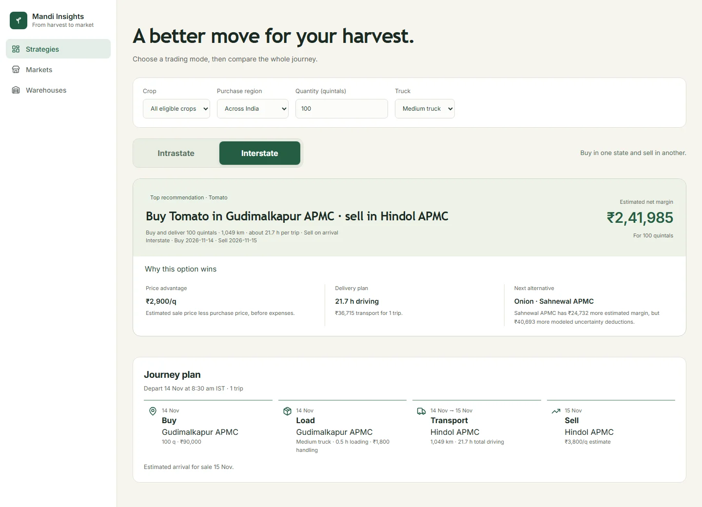
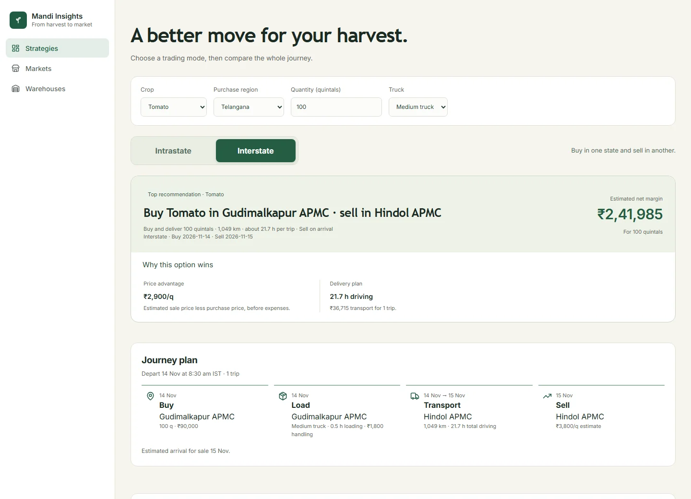
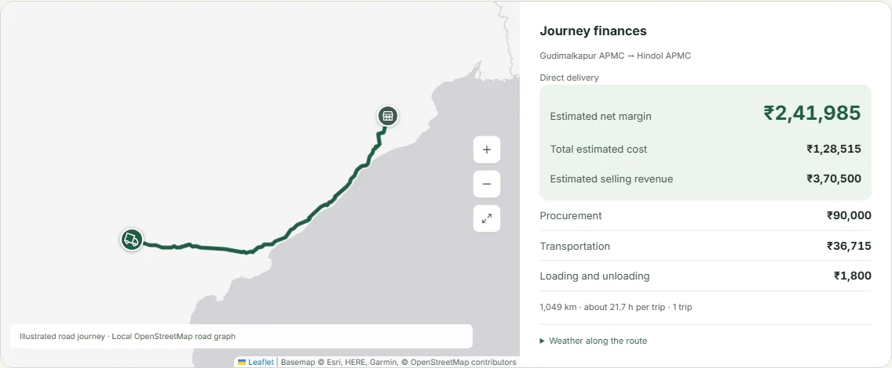
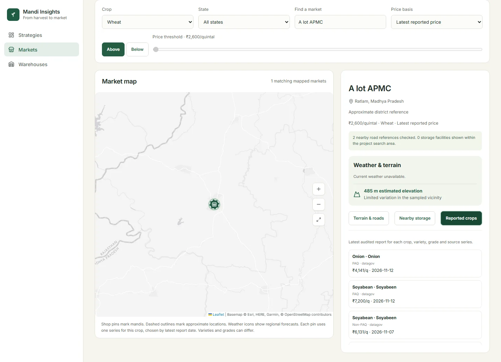
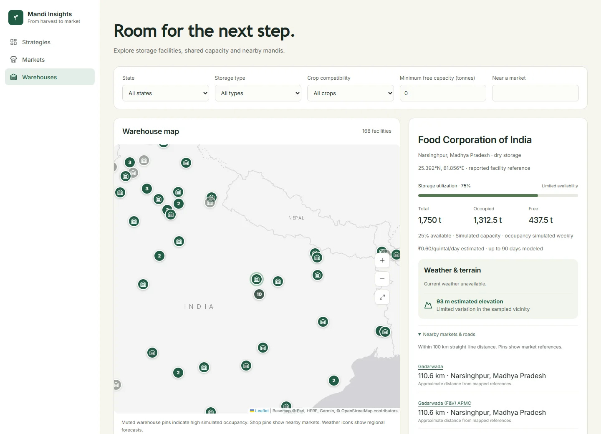

# Mandi Insights

Compare Indian wholesale market prices, plan crop trades, and see how transport and storage affect the margin.



   

## Explore the application

**Strategies** finds eligible markets by crop and purchase region. Compare intrastate and interstate plans, then inspect the route, timing, and costs.





**Markets** lets you search mandis, compare crop prices, and inspect reported varieties and grades.



**Warehouses** shows facility locations, compatible crops, nearby markets, and modeled storage capacity.



## Run locally

Use Python 3.13 and Node.js 22.12+ or 24+. The project uses FastAPI, Pandas, Parquet, and SQLite on the backend, with React, TypeScript, Vite, and Leaflet on the frontend.

```powershell
git clone https://github.com/akshat12bhardwaj/BDA.git
cd BDA
python -m pip install -r requirements.txt
npm ci --prefix frontend
```

Copy the [local data bundle](Documentation/Local_Data_Bundle.md) into the checkout. Then run these in separate terminals from the project root:

```powershell
python -B -m uvicorn Code.api.main:app --host 127.0.0.1 --port 8000
```

```powershell
npm run dev --prefix frontend
```

Open [Mandi Insights locally](http://127.0.0.1:5173/). For the notebook walkthrough, run `python -m jupyterlab --notebook-dir=Notebook` and start with the [project overview](Notebook/01_Project_Overview.ipynb).

## Data and forecasts

AGMARKNET and data.gov.in supply mandi reports. The daily persistence model carries forward the last eligible report in INR per quintal. Exact future quotes cover 7, 14, and 30 days from issuance. The planner screens up to 12 direct-ranked pairs per mode and three compatible warehouses per pair. Storage availability, charges, and some route distances are modeled.

The Windows refresh and publication schedules are 22:30 and 00:05 IST. Existing local data can be published for the current date without a source download:

```powershell
python -B -m Code.intelligence.refresh --batch-only
```

For a bounded source refresh, configure `DATAGOV_API_KEY` or the local `.secrets/datagov_api_key` file and run `powershell -NoProfile -ExecutionPolicy Bypass -File Code/intelligence/run_refresh.ps1 -Execute`. The [implementation notes](Documentation/Mandi_Insights_Revamp.md) describe publication and logistics.

## Verify

```powershell
python -B -m pytest -q -p no:cacheprovider Code/tests -k "not test_real_freeze_verifies_without_reading_records"
npm test --prefix frontend -- --maxWorkers=2
npm run build --prefix frontend
```

The D-52 exclusion is the historical pre-run assertion that expects an absent lock. The completed-run integrity check stays in the suite. Full research integrity checks require Git history and the local research artifacts. Spark is optional.

- `Code/` — API, data pipelines, research, routing, and tests
- `frontend/` — React application
- [`Notebook/`](Notebook/) — 14 executable notebooks
- [`Documentation/`](Documentation/) — data lineage, assumptions, and research decisions

<details>
<summary>All 14 notebooks</summary>

- [Project Overview](Notebook/01_Project_Overview.ipynb)
- [Data Collection](Notebook/02_Data_Collection.ipynb)
- [Exploratory Data Analysis](Notebook/03_Exploratory_Data_Analysis.ipynb)
- [Data Cleaning](Notebook/04_Data_Cleaning.ipynb)
- [Feature Engineering](Notebook/05_Feature_Engineering.ipynb)
- [Feature Selection](Notebook/06_Feature_Selection.ipynb)
- [Model Development](Notebook/07_Model_Development.ipynb)
- [Model Comparison](Notebook/08_Model_Comparison.ipynb)
- [Forecasting](Notebook/09_Forecasting.ipynb)
- [Trading Strategies](Notebook/10_Trading_Strategies.ipynb)
- [Logistics And Storage](Notebook/11_Logistics_And_Storage.ipynb)
- [Multi Day Planning](Notebook/12_Multi_Day_Planning.ipynb)
- [Application Integration](Notebook/13_Application_Integration.ipynb)
- [Results And Conclusions](Notebook/14_Results_And_Conclusions.ipynb)

</details>
