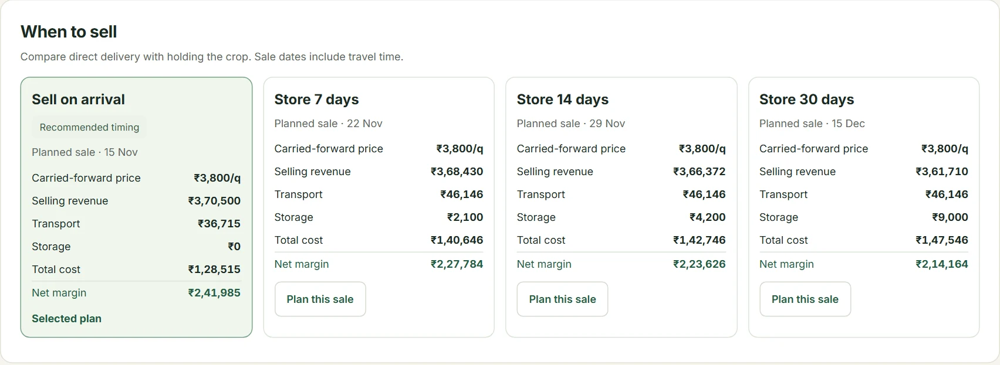

<h1 align="center">Mandi Insights</h1>
<p align="center"><strong>Compare mandi prices. Plan the journey. See what the trade could earn.</strong></p>
<p align="center">
  
  
  
  
</p>

<p align="center">
  
</p>

<p align="center"><a href="#explore-the-app">Explore the App</a> · <a href="#how-it-works">How It Works</a> · <a href="#run-locally">Run Locally</a> · <a href="#testing">Testing</a> · <a href="#notebooks">Notebooks</a></p>

## Explore the app

| Strategies dashboard | Crop and purchase location |
|---|---|
|  |  |
| Compare the recommended trade with alternatives. | Narrow the search by crop, purchase region, load, and truck. |

| Market discovery | Warehouse explorer |
|---|---|
|  |  |
| Find mandis and inspect their reported crops, varieties, and grades. | Inspect a facility’s modeled capacity and nearby markets. |

| Route and trading finances | Storage-based trade planning |
|---|---|
|  |  |
| Follow the mapped journey and see how freight and other costs affect margin. | Compare direct sale with storage and later sale dates. |

## Features

- **Dynamic discovery.** Crop, purchase location, and selling destination options depend on the eligible data available for the selected trading mode.
- **Intrastate and interstate strategies.** Compare estimated margins for the same load and truck, with published crop price forecasts where supported.
- **Market and warehouse exploration.** Check market reports, crop compatibility, and facility location evidence before inspecting a trade.
- **Route and storage economics.** Review transport, handling, and storage costs alongside estimated sale proceeds.
- **Daily refresh and publication.** The local workflow updates recent reports and builds the dataset used by the dashboard.

## How it works

| Stage | What it does |
|---|---|
| Data collection | Retrieves and validates mandi reports from AGMARKNET via data.gov.in. |
| Forecasting | Publishes persistence estimates for eligible market series at supported horizons. |
| Trading strategy | Compares eligible buy and sell pairs using estimated prices, transport costs, handling losses, and storage scenarios. |
| Dashboard | Presents recommendations, market and warehouse profiles, routes, and cost breakdowns. |

See the [implementation notes](Documentation/Mandi_Insights_Revamp.md) for publication and logistics details.

## Run locally

Use **Python 3.13** and **Node.js 22.12+ (22.x) or 24+** with Windows PowerShell.

```powershell
git clone https://github.com/akshat12bhardwaj/BDA.git
cd BDA
python -m pip install -r requirements.txt
npm ci --prefix frontend
```

Copy the [required local data bundle](Documentation/Local_Data_Bundle.md) into the checkout. From the project root, start FastAPI and Vite in separate terminals.

```powershell
python -B -m uvicorn Code.api.main:app --host 127.0.0.1 --port 8000
```

```powershell
npm run dev --prefix frontend
```

Open [Mandi Insights locally](http://127.0.0.1:5173/).

<details>
<summary>Optional data refresh and notebook commands</summary>

Publish a current batch from existing local inputs.

```powershell
python -B -m Code.intelligence.refresh --batch-only
```

For a bounded source refresh, configure the `DATAGOV_API_KEY` environment variable or the local `.secrets/datagov_api_key` file.

```powershell
powershell -NoProfile -ExecutionPolicy Bypass -File Code/intelligence/run_refresh.ps1 -Execute
```

Start the notebook walkthrough.

```powershell
python -m jupyterlab --notebook-dir=Notebook
```

</details>

## Project structure

```text
BDA/
├── Code/                API, pipelines, routing, research, and tests
├── frontend/            React and TypeScript dashboard
├── Notebook/            Executable project walkthrough
├── Dataset/             Historical input data
├── Dataset_Candidates/  Candidate-source manifests and local inputs
├── Processed_Data/      Processed datasets and publication assets
├── Documentation/       Setup, data lineage, and research decisions
└── Outputs/             Research and evaluation outputs
```

## Testing

```powershell
python -B -m pytest -q -p no:cacheprovider Code/tests -k "not test_real_freeze_verifies_without_reading_records"
npm test --prefix frontend -- --maxWorkers=2
npm run build --prefix frontend
```

The backend command excludes the historical D-52 pre-run assertion, which expects the lock to be absent. It still includes the completed-run integrity check. Research integrity checks require Git history and the local research artifacts. Spark is optional.

## Notebooks

<details>
<summary>Explore all 14 notebooks</summary>

- [Project Overview](Notebook/01_Project_Overview.ipynb)
- [Data Collection](Notebook/02_Data_Collection.ipynb)
- [Exploratory Data Analysis](Notebook/03_Exploratory_Data_Analysis.ipynb)
- [Data Cleaning](Notebook/04_Data_Cleaning.ipynb)
- [Feature Engineering](Notebook/05_Feature_Engineering.ipynb)
- [Feature Selection](Notebook/06_Feature_Selection.ipynb)
- [Model Development](Notebook/07_Model_Development.ipynb)
- [Model Comparison](Notebook/08_Model_Comparison.ipynb)
- [Forecasting](Notebook/09_Forecasting.ipynb)
- [Trading Strategies](Notebook/10_Trading_Strategies.ipynb)
- [Logistics And Storage](Notebook/11_Logistics_And_Storage.ipynb)
- [Multi Day Planning](Notebook/12_Multi_Day_Planning.ipynb)
- [Application Integration](Notebook/13_Application_Integration.ipynb)
- [Results And Conclusions](Notebook/14_Results_And_Conclusions.ipynb)

</details>

## Data sources and scope

AGMARKNET mandi reports come from data.gov.in. The daily persistence forecast carries forward the last eligible reported price in ₹ per quintal and publishes quotes for 7, 14, and 30 days from issuance. Transport costs, warehouse availability, and storage charges use modeled assumptions.
